<a href="https://t.me/frankydzoro">
  <picture>
    <source media="(prefers-color-scheme: dark)" srcset="assets/serp-climb-dark.svg">
    <source media="(prefers-color-scheme: light)" srcset="assets/serp-climb-light.svg">
    
  </picture>
</a>

<!-- <pre>
peter@grish: ~ — zsh

   ██████╗ ██████╗ ██╗███████╗██╗  ██╗        .-----.   
  ██╔════╝ ██╔══██╗██║██╔════╝██║  ██║       / .---. \  
  ██║  ███╗██████╔╝██║███████╗███████║      | | ··· | | 
  ██║   ██║██╔══██╗██║╚════██║██╔══██║       \ '---' /  
  ╚██████╔╝██║  ██║██║███████║██║  ██║        '-----'\  
   ╚═════╝ ╚═╝  ╚═╝╚═╝╚══════╝╚═╝  ╚═╝                \\

peter@grish:~$ whoami
Peter Grishechkin — Head of SEO, Buenos Aires
15+ years in Yandex &amp; Google ranking and ecommerce growth.
Now building SEO tooling: entity-based SERP analysis, AI citations, LLMs, MCP.

peter@grish:~$ ls ~/projects
<a href="https://github.com/Peter-Grishechkin/serp-xray">serp-xray</a>               TS    SERP entity gaps: top-20 → LLM → knowledge graph vs a page
<a href="https://github.com/Peter-Grishechkin/grish-seo-audit-hermes">grish-seo-audit-hermes</a>  Py    SEO-audit skill for Hermes Agent: 19+ roles, 59-script kit
<a href="https://github.com/Peter-Grishechkin/bukvarix-mcp">bukvarix-mcp</a>            JS    MCP server for Bukvarix: keywords &amp; domains, Yandex/Google
<a href="https://github.com/Peter-Grishechkin/topvisor-mcp">topvisor-mcp</a>            TS    MCP fork for Topvisor API v2: Yandex/Google rank tracking
<a href="https://github.com/Peter-Grishechkin/Limitwick">Limitwick</a>               Swift macOS menu bar meter for Codex &amp; Claude Code usage limits

peter@grish:~$ cat stack.txt
seo    SERP analysis · entities · knowledge graphs · AI citations · GEO
ai     LLMs · MCP servers · agent skills · Claude Code · Codex
code   Python · TypeScript · Swift · Next.js · FastAPI

peter@grish:~$ contacts
blog   <a href="https://grish.me">grish.me</a>
tg     <a href="https://t.me/seo_and_sem">t.me/seo_and_sem</a>   «Разум Петра (SEO, AI и около)», RU
dm     <a href="https://t.me/frankydzoro">@frankydzoro</a>       audits &amp; questions
x      <a href="https://x.com/frankydzoro1">@frankydzoro1</a>

peter@grish:~$ █
</pre> -->
